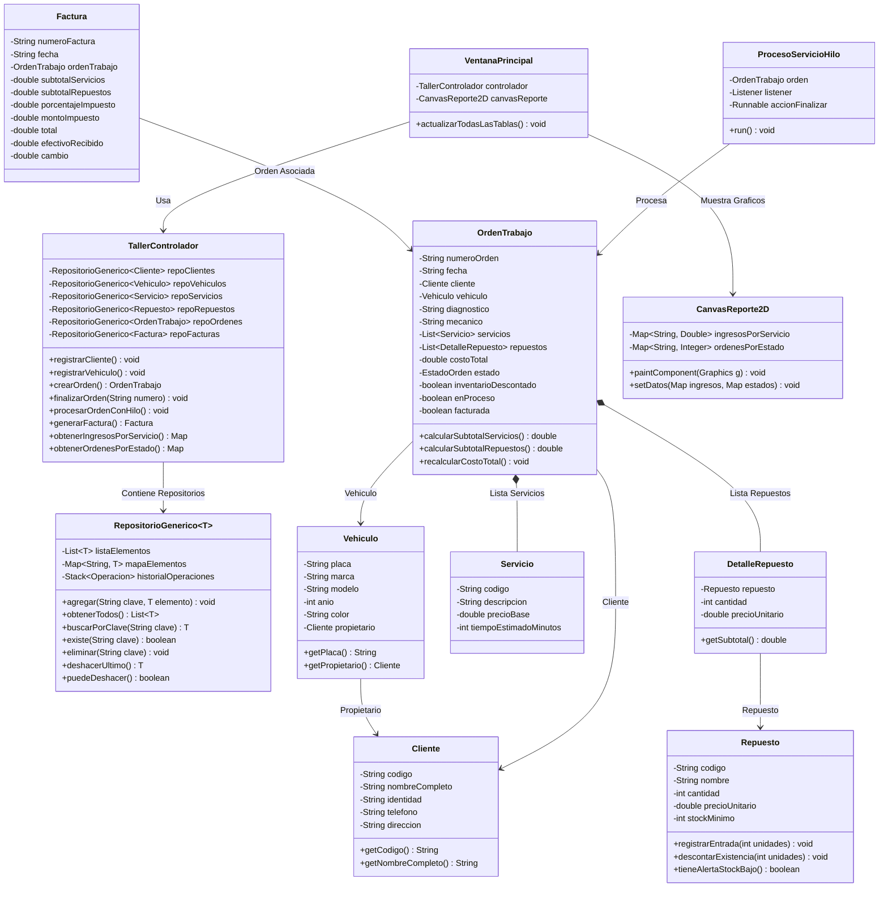

# AutoTech Solutions - Sistema de Gestión de Taller Automotriz

**Asignatura:** Programación Avanzada I  
**Catedrático:** Master Kevin Alexander Maradiaga  
**Modalidad:** Examen Práctico Integrador Java  
**Repositorio GitHub:** [https://github.com/jomudev/AutoTechSolutions-Taller](https://github.com/jomudev/AutoTechSolutions-Taller)

---

## 1. Descripción del Proyecto

El sistema es una aplicación de escritorio desarrollada en **Java con interfaz gráfica Swing**, diseñada para la administración integral de las operaciones del taller automotriz **AutoTech Solutions**.

Implementa persistencia exclusivamente en **memoria RAM** utilizando estructuras de datos fundamentales (`ArrayList`, `HashMap`, `Stack`), programación genérica (`RepositorioGenerico<T>`), excepciones personalizadas, programación multihilo y generación de gráficos estadísticos 2D manuales con `Graphics2D` sin bibliotecas externas.

---

## 2. Arquitectura del Software (Patrón MVC)

El código fuente está estrictamente organizado según las pautas de clase en los siguientes paquetes:

* **`main`**: Clase principal `Main.java` encargada de inicializar el Look & Feel y levantar la interfaz en el Event Dispatch Thread (EDT).
* **`modelo`**: Clases del dominio del negocio:
  * `Cliente.java` (Código, nombre, identidad, teléfono, dirección).
  * `Vehiculo.java` (Placa, marca, modelo, año, color, cliente propietario).
  * `Servicio.java` (Código, descripción, precio base, tiempo estimado).
  * `Repuesto.java` (Código, nombre, cantidad, precio unitario, stock mínimo).
  * `DetalleRepuesto.java` (Repuesto asignado, cantidad y subtotal).
  * `EstadoOrden.java` (Enum: `PENDIENTE`, `EN_PROCESO`, `FINALIZADA`, `CANCELADA`).
  * `OrdenTrabajo.java` (Número, cliente, vehículo, diagnóstico, mecánico, servicios, repuestos, estado, control de inventario).
  * `Factura.java` (Número de factura, orden asociada, subtotales, impuesto configurable, total, efectivo y cambio).
* **`repositorio`**:
  * `RepositorioGenerico<T>.java`: Implementación reutilizable con `ArrayList` para listados ordenados, `HashMap` para indexación y búsquedas O(1), y `Stack` para deshacer (Undo) asegurando consistencia en todas las estructuras.
* **`controlador`**:
  * `TallerControlador.java`: Orquesta los repositorios, las validaciones de negocio, el cálculo de facturas, el control de inventario y la ejecución asíncrona de los hilos.
* **`vista`**:
  * `VentanaPrincipal.java`: Ventana central con navegación por pestañas (`JTabbedPane`), tablas `JTable`, formularios, validaciones visuales y barra de progreso.
  * `CanvasReporte2D.java`: Panel personalizado que hereda de `JPanel` y sobreescribe `paintComponent(Graphics g)` para dibujar manualmente gráficos de barras mediante `Graphics2D`.
* **`excepciones`**: Excepciones personalizadas requeridas:
  * `StockInsuficienteException.java`: Rechaza consumos de inventario superiores al stock disponible.
  * `ClienteNoEncontradoException.java`: Disparada al buscar o asociar un cliente inexistente.
  * `PagoInsuficienteException.java`: Rechaza pagos en efectivo inferiores al total facturado.
* **`hilos`**:
  * `ProcesoServicioHilo.java`: Implementa `Runnable` para simular las 10 etapas del servicio automotriz (duración total > 5 segundos), actualizando la interfaz vía `SwingUtilities.invokeLater` sin congelar la ventana y bloqueando ejecuciones duplicadas.

---

## 3. Diagrama UML de Clases



---

## 4. Guía de Demostración Paso a Paso y Capturas de Pantalla

### Paso 1: Gestión de Clientes (Módulo 1)
Se registra un cliente con código único (`CLI-001`), nombre completo, identidad, teléfono y dirección. El sistema valida campos obligatorios y códigos duplicados.


---

### Paso 2: Gestión de Vehículos (Módulo 2)
Se registra el vehículo con placa `HAA-1234` asociándolo al cliente propietario registrado previamente. Permite búsqueda por placa y filtrado de vehículos por cliente.


---

### Paso 3: Catálogo de Servicios Mecánicos (Módulo 3)
El catálogo incluye los servicios obligatorios: Cambio de aceite, Revisión de frenos, Diagnóstico electrónico, Alineamiento y Mantenimiento general, validando precios mayores a cero.


---

### Paso 4: Inventario de Repuestos (Módulo 4)
Administración de repuestos con control de existencia, precio unitario, stock mínimo, entradas de almacén y alertas automáticas de existencia baja o agotada.


---

### Paso 5: Órdenes de Trabajo y Concurrencia con Hilos (Módulos 5 y 10)
Se genera la orden `ORD-001` seleccionando el cliente, vehículo, diagnóstico, servicios mecánicos y repuestos requeridos. Al presionar **"Procesar con Hilo (>= 5 seg)"**:
* Se inicia el hilo en segundo plano simulando las etapas técnicas del servicio durante más de 5 segundos.
* Se actualiza la barra de progreso en el EDT sin congelar la interfaz.
* Se bloquea la ejecución duplicada.
* Al concluir, la orden pasa a estado `Finalizada` y se descuentan las existencias del inventario una sola vez.


---

### Paso 6: Módulo de Facturación (Módulo 6 y Módulo 9)
Permite facturar únicamente órdenes finalizadas. Calcula subtotales de servicios y repuestos, aplica el porcentaje de impuesto configurable (15% por defecto) y totaliza.
* Si el cliente paga una cantidad menor al total, se dispara la excepción personalizada `PagoInsuficienteException` mostrando el mensaje sin cerrar el programa.
* Al registrar un pago válido, se calcula el cambio a entregar y se emite la factura.


---

### Paso 7: Reportes Gráficos Java 2D (Módulo 7)
Lienzo manual utilizando `JPanel`, `Graphics2D` y `paintComponent()`. Dibuja dos gráficos de barras alimentados en tiempo real por los datos en memoria:
1. **Ingresos acumulados por servicio mecánico (L.)**.
2. **Distribución de órdenes por estado (Pendiente, En proceso, Finalizada, Cancelada)**.


---

## 5. Instrucciones de Ejecución

### Opción 1: Ejecución con Maven o NetBeans
1. Abrir **NetBeans IDE**.
2. Seleccionar **File -> Open Project** y elegir la carpeta del proyecto `AutoTechSolutions`.
3. Hacer clic en **Run Project** (`F6`).

### Opción 2: Compilación y Ejecución por Terminal
```bash
# Compilar todo el proyecto
javac -d bin $(find src/main/java -name "*.java")

# Ejecutar la aplicación
java -cp bin main.Main
```
