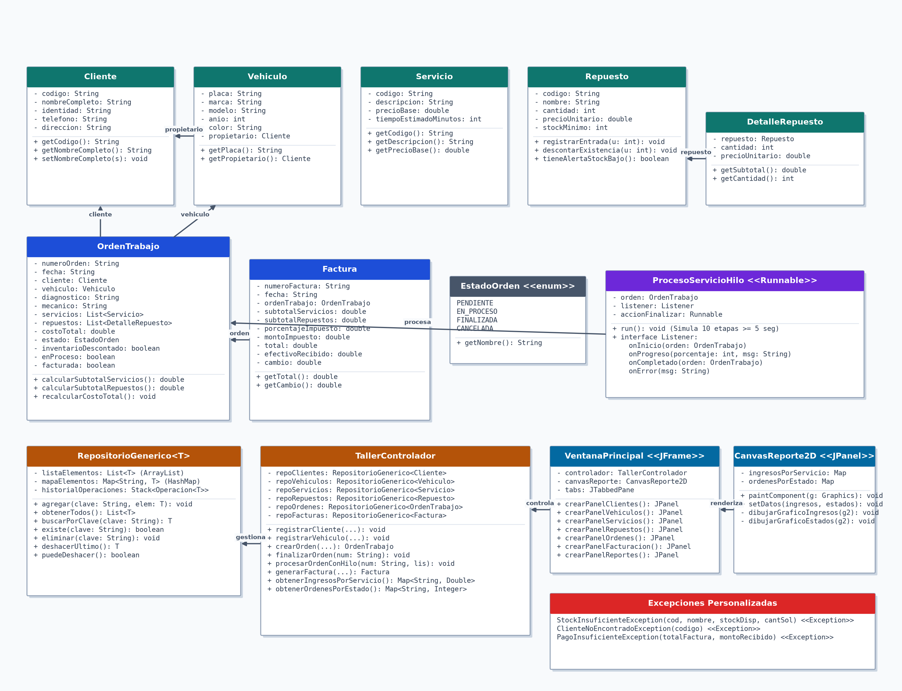

# Universidad Tecnológica de Honduras (UTH)
### Facultad de Ingeniería en Computación
**Asignatura:** Programación Avanzada I  
**Docente:** Kevin Alexander Maradiaga  
**Estudiante:** Hector Joann Murillo Mejia  
**Cuenta:** 202210060221  
**Trabajo:** Informe Proyecto Examen Segundo Parcial  
**Repositorio GitHub:** [https://github.com/jomudev/AutoTechSolutions-Taller](https://github.com/jomudev/AutoTechSolutions-Taller)

---

## 1. Introducción y Enunciado General
Este proyecto consiste en el desarrollo de un sistema de escritorio para el taller automotriz **AutoTech Solutions**, correspondiente al examen práctico integrador de la clase Programación Avanzada I. El propósito del programa es automatizar la administración del taller, permitiendo registrar clientes, vehículos, controlar el inventario de repuestos, procesar órdenes de trabajo, generar facturas y visualizar reportes estadísticos.

Siguiendo las instrucciones del examen, el sistema no utiliza bases de datos externas ni archivos de texto; toda la información se maneja exclusivamente en memoria RAM. Para cumplir con los requerimientos técnicos, se aplicaron conceptos de programación orientada a objetos (POO), clases genéricas (`RepositorioGenerico<T>`), colecciones (`ArrayList`, `HashMap`, `Stack`), excepciones personalizadas, multihilos para tareas en segundo plano y gráficos generados con Java 2D.

---

## 2. Arquitectura del Software y Organización en Paquetes
El código se organizó utilizando el patrón Modelo-Vista-Controlador (MVC) para separar la lógica del negocio de la interfaz gráfica y los datos. El proyecto se divide en los siguientes paquetes:

* **`main`**: Contiene la clase `Main.java`, donde inicia la ejecución del programa, se configura el Look and Feel (Nimbus) y se abre la ventana principal dentro del Event Dispatch Thread (EDT).
* **`modelo`**: Contiene las clases que representan los datos del sistema: `Cliente`, `Vehiculo`, `Servicio`, `Repuesto`, `DetalleRepuesto`, `OrdenTrabajo`, `Factura` y el enum `EstadoOrden`.
* **`repositorio`**: Incluye la clase `RepositorioGenerico<T>`, utilizada para almacenar los registros en memoria. Utiliza un `ArrayList` para mostrar los datos en las tablas, un `HashMap` para realizar búsquedas rápidas por clave (código o placa) y un `Stack` para la función de deshacer (Undo).
* **`controlador`**: Contiene `TallerControlador.java`, que se encarga de aplicar las reglas de validación, comunicar la vista con los repositorios, gestionar la facturación y lanzar los hilos de procesamiento.
* **`vista`**: Incluye `VentanaPrincipal.java`, que contiene los formularios con pestañas (`JTabbedPane`), tablas y botones de la interfaz, y `CanvasReporte2D.java`, un panel que dibuja los gráficos de barras usando `paintComponent()` y `Graphics2D`.
* **`excepciones`**: Contiene las excepciones personalizadas del proyecto: `StockInsuficienteException`, `ClienteNoEncontradoException` y `PagoInsuficienteException`.
* **`hilos`**: Contiene la clase `ProcesoServicioHilo.java`, que implementa `Runnable` para simular la atención técnica del vehículo durante al menos 5 segundos en segundo plano, sin bloquear la interfaz.

---

## 3. Diagrama UML de Clases
A continuación se muestra el diagrama de clases del sistema, donde se representan las entidades creadas, sus atributos, métodos principales y las relaciones de asociación, composición y dependencia entre cada módulo:



En el diagrama se destacan las siguientes relaciones:
* **Vehículo - Cliente:** Cada objeto `Vehiculo` guarda una referencia al `Cliente` que es su dueño.
* **Orden de Trabajo:** La clase `OrdenTrabajo` contiene listas de `Servicio` y `DetalleRepuesto`, sumando los subtotales para calcular el costo total de la orden.
* **Facturación:** La clase `Factura` se asocia con una `OrdenTrabajo` en estado finalizada para calcular los subtotales, el impuesto y el total a pagar.
* **Controlador y Repositorios:** `TallerControlador` maneja las instancias de `RepositorioGenerico<T>` para cada modelo y sirve de enlace con la `VentanaPrincipal`.

---

## 4. Cumplimiento de los Requerimientos Funcionales
* **Módulo 1: Clientes**  
  Permite registrar, buscar, modificar y eliminar clientes. Valida que no queden campos vacíos (código, nombre, identidad, teléfono, dirección) y evita que se repitan códigos ya registrados.

* **Módulo 2: Vehículos**  
  Registra vehículos vinculándolos a un cliente mediante una lista desplegable. Valida que la placa no esté duplicada, permite buscar por placa y filtrar los vehículos de un cliente en específico.

* **Módulo 3: Servicios mecánicos**  
  Incluye el catálogo con los 5 servicios requeridos: cambio de aceite (L. 850.00), revisión de frenos (L. 1,200.00), diagnóstico electrónico (L. 950.00), alineamiento (L. 1,100.00) y mantenimiento general (L. 2,500.00). Permite ingresar nuevos servicios validando que el precio sea mayor a cero.

* **Módulo 4: Inventario**  
  Controla los repuestos con su código, nombre, cantidad, precio unitario y stock mínimo. Permite registrar entradas de unidades, no acepta números negativos y muestra alertas cuando el inventario baja del mínimo o se agota.

* **Módulo 5: Órdenes de trabajo**  
  Permite crear órdenes asignando cliente, vehículo, diagnóstico, mecánico, servicios y repuestos. El costo total se calcula automáticamente sumando ambos conceptos. Los repuestos se descuentan del inventario una sola vez cuando la orden pasa a estado Finalizada.

* **Módulo 6: Facturación**  
  Genera la factura únicamente si la orden está finalizada. Separa los subtotales de mano de obra y repuestos, aplica el 15% de impuesto (configurable) y calcula el cambio según el efectivo entregado.

* **Módulo 7: Reportes Java 2D**  
  Utiliza una clase que hereda de `JPanel` y sobreescribe `paintComponent()`. Con `Graphics2D` se dibujan dos gráficos de barras con los datos en memoria: uno para los ingresos por servicio y otro para la cantidad de órdenes por estado.

* **Módulo 8: Genéricos y colecciones**  
  La clase `RepositorioGenerico<T>` utiliza un `ArrayList` para llenar los `JTable`, un `HashMap` para buscar rápidamente por ID/placa, y un `Stack` para la opción de deshacer (Undo). Al deshacer una acción, se actualizan tanto la lista como el mapa para mantener los datos sincronizados.

* **Módulo 9: Excepciones personalizadas**  
  Se crearon y manejaron las tres excepciones pedidas:
  * `StockInsuficienteException`: si se piden más repuestos de los que hay en bodega.
  * `ClienteNoEncontradoException`: si se busca un código de cliente que no existe.
  * `PagoInsuficienteException`: si el efectivo entregado en caja no cubre el total de la factura.  
  Todas se capturan con bloques `try-catch` y se muestran con `JOptionPane` para evitar que el programa se caiga.

* **Módulo 10: Multihilos**  
  La clase `ProcesoServicioHilo` implementa `Runnable` y simula la atención del vehículo en 10 pasos con pausas de 550 ms (duración total de 5.5 segundos). El avance se envía al EDT con `SwingUtilities.invokeLater` para actualizar la barra de progreso sin trabar la pantalla, y se valida que una misma orden no se procese dos veces al mismo tiempo.

---

## 5. Demostración del Sistema y Capturas de Pantalla
Para la demostración en clase se siguió el flujo completo de trabajo, desde el registro inicial hasta la facturación y la visualización de los gráficos:

### Paso 1: Registro y consulta de clientes
Se captura el cliente Hector Murillo con código 'CLI-001'. La tabla refleja inmediatamente el registro.


### Paso 2: Registro de vehículo asociado al propietario
Se registra el vehículo Ford Escape año 2011 con placa 'JAM6446', seleccionando al cliente CLI-001 en el selector de propietarios.


### Paso 3: Catálogo de servicios mecánicos
Visualización de los 5 servicios mecánicos base disponibles con sus precios unitarios y tiempos estimados.


### Paso 4: Control de inventario y alertas
El módulo de inventario muestra las existencias de filtros, aceites y pastillas de freno, permitiendo registrar entradas y mostrando el semáforo de estado de existencias.


### Paso 5: Creación de orden y procesamiento asíncrono con hilo
Se genera la orden ORD-001 vinculando al cliente, vehículo, servicios y repuestos. Al presionar 'Procesar con Hilo (>= 5 seg)', la barra de progreso avanza en tiempo real mostrando los pasos técnicos, finaliza la orden y descuenta las existencias una sola vez.


### Paso 6: Liquidación y facturación
Se selecciona la orden finalizada, calculando subtotales de L. 1,200.00 en servicios y L. 0.00 en repuestos. Con 15% de impuesto el total resulta en L. 1,380.00. Se demuestra el rechazo ante pagos inferiores (`PagoInsuficienteException`) y el cálculo exacto del cambio ante pagos válidos.


### Paso 7: Visualización de reportes Java 2D
El canvas Java 2D procesa en tiempo real los registros en memoria para renderizar las barras de ingresos por servicio y el conteo de órdenes por estado.


---

## 6. Instrucciones de Compilación y Ejecución
El proyecto es compatible con Java 17 LTS o superior y cuenta con el archivo de configuración Maven `pom.xml` estándar para su apertura inmediata en NetBeans IDE.

### Ejecución en NetBeans IDE
1. Abrir NetBeans IDE.
2. Ir a **File -> Open Project** y seleccionar la carpeta del proyecto `Examen AutoTechSolutions`.
3. Hacer clic derecho sobre el proyecto y presionar **Run** (o presionar la tecla `F6`).

### Ejecución por Terminal
```bash
# Compilar el proyecto hacia la carpeta bin
javac -d bin $(find src/main/java -name "*.java")

# Ejecutar la aplicación gráfica Swing
java -cp bin main.Main
```

---

## 7. Conclusiones
1. Se completaron los 10 módulos solicitados para el taller AutoTech Solutions, cumpliendo con las validaciones de datos, persistencia en memoria RAM y el manejo de excepciones sin que la aplicación se cierre ante errores.
2. Se aplicó el patrón MVC separando la interfaz de la lógica. Con la clase `RepositorioGenerico<T>` se manejaron las estructuras vistas en clase: `ArrayList` para llenar las tablas, `HashMap` para buscar registros por código o placa de forma rápida, y `Stack` para implementar el botón de deshacer (Undo) restaurando los datos anteriores.
3. El uso de hilos (`Runnable`) permitió simular el tiempo de servicio de la orden (más de 5 segundos) sin congelar la ventana, actualizando la barra de progreso mediante `SwingUtilities.invokeLater` en el EDT. Además, los reportes se dibujaron manualmente usando `Graphics2D` y `paintComponent` sin usar librerías externas.
